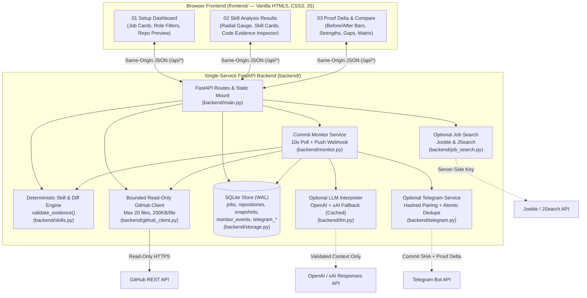

# SkillPath AI

> **AI Career Coach & Verifiable Portfolio Evidence Ledger**
> *Match what your GitHub code proves to real job requirements — with deterministic file/line citations, automatic commit reassessment, and live Proof Deltas.*

[](https://github.com/vedantsable56/Skill_Path/actions)
[](https://www.python.org/)
[](https://fastapi.tiangolo.com)
[](LICENSE)

---

## 1. Project Overview

**SkillPath AI** is an evidence-first AI Career Coach built for the **W-PS-2 · AI Career Coach** challenge. It evaluates how a developer's actual GitHub repository aligns with real job and internship postings, identifies evidence-backed skill gaps without making unsupported personal judgments, and automatically reassesses the portfolio whenever new code is committed.

* **The Core Problem:** Resumes rely on self-reported buzzwords, while generic AI career chatbots hallucinate qualifications or penalize candidates with opaque scores. Meanwhile, recruiters do not have time to manually audit every file and commit across a candidate's GitHub repositories.
* **The Solution:** SkillPath AI connects a real job posting with a bounded, read-only GitHub repository scan. It extracts required and preferred skills, validates actual source code syntax (filtering out comments, docstrings, and dependency manifests), and links every demonstrated skill to an exact **GitHub file path, 1-indexed line range, code excerpt, and commit SHA**.
* **Primary Differentiator — The Proof Delta:** When a developer pushes a new commit to close a skill gap, SkillPath AI detects the new commit SHA (via GitHub push webhook or background polling), creates an immutable SQLite snapshot, and computes a **Proof Delta**—showing the exact before-and-after change in validated code evidence, skill status transitions, and role fit score.

---

## 2. Problem and Solution

### Why Current Approaches Fall Short
1. **Unverifiable Self-Reported Skills:** Listing "FastAPI, RAG, SQL, Pytest" on a resume or README does not prove implementation experience.
2. **Time-Consuming Manual Repository Audits:** Inspecting source trees, test assertions, and commit histories manually across multiple repositories is slow and inconsistent.
3. **Static One-Time Assessments:** When a student learns a missing skill and pushes new code over the weekend, static resume reviews remain outdated.
4. **Unfair Negative Claims:** Treating a missing keyword in one repository as proof that a developer lacks a skill is inaccurate and unfair.

### How SkillPath AI Solves This
```text
Real Job Posting (URL + Description)
  ──> Conservative Requirement Extraction (Required vs. Preferred + Source Excerpts)
  ──> Bounded Read-Only GitHub Inspection (Max 20 files, 200 KB/file, 1.5 MB total)
  ──> Deterministic Code Evidence Validation (Exact File Path + Line Range + Excerpt)
  ──> Honest Scope Classification ("Demonstrated", "Partially Demonstrated", or "Not demonstrated in this inspected scope")
  ──> Actionable Next-Proof Tasks (File-contextualized recommendations for missing evidence)
  ──> New Git Commit Detected (Webhook or 10s Polling)
  ──> Automatic Reassessment & Proof Delta (Before/After Evidence Comparison + Telegram Alert)
```

---

## 3. Core Features

All capabilities below are implemented in the repository and verified by automated tests:

1. **Job Requirement Ingestion & Source Traceability (`backend/main.py`, `backend/skills.py`):**
   * Ingests public job/internship postings with retained `source_url`, `title`, optional `company`/`city`, and `description` (including a server-side SSRF-safe URL text extractor at `POST /api/jobs/fetch`).
   * Distinguishes verified external job URLs from synthetic role benchmarks (`skillpath.local`).
   * Extracts supported technical skill rules across Python, JavaScript, TypeScript, Java, C++, FastAPI, Flask, React, HTML/CSS, REST APIs, SQL databases, automated testing, Docker, CI/CD, deployment, AWS, Azure, Machine Learning, Deep Learning, NLP, RAG, embeddings/vector search, LLM integration, data pipelines, modular architecture, interactive UIs, and Git/GitHub, preserving `required` vs. `preferred` classification and the exact source line/excerpt.

2. **Bounded, Read-Only GitHub Repository Inspection (`backend/github_client.py`):**
   * Uses the GitHub REST API to read repository metadata, default branch, latest commit SHA, recursive file tree, and file contents without cloning, installing, or executing untrusted code.
   * Enforces strict safety and resource bounds (`max_files=20`, `max_file_bytes=200 KB`, `max_total_bytes=1.5 MB`).
   * Prioritizes executable source, API, ML/RAG, ingestion, and test files while skipping binaries, lockfiles, minified bundles, vendor/dependency directories (`node_modules`, `.venv`), and secret-named files (`.env`, `credentials`, private keys).
   * Treats `README.md`, `docs/`, and package manifests (`requirements.txt`, `package.json`) as `context_only` (`strength=0.32`), ensuring documentation or dependency lists alone never mark an implementation skill as `demonstrated`.

3. **Deterministic Skill Assessment & Citation Validation (`backend/skills.py`):**
   * Scans non-comment lines against rule-specific syntax patterns. Complex skills require multi-part proof (e.g., `automated_testing` requires both a test declaration *and* an assertion; `retrieval_augmented_generation` requires both a retrieval operation *and* vector-store integration).
   * Every candidate citation is cross-checked by `validate_evidence()` against the exact retrieved file lines before storage.
   * Assigns one of three transparent statuses: **`demonstrated`**, **`partially demonstrated`**, or **`not demonstrated in this inspected scope`**.
   * Calculates the role fit score deterministically (`Required = 1.0`, `Preferred = 0.5`; `Demonstrated = 1.0`, `Partial = 0.5`, `Not demonstrated in scope = 0.0`). **An LLM never determines skill statuses or numeric scores.**

4. **Immutable Snapshots & Proof Delta Comparison (`backend/storage.py`, `backend/skills.py`):**
   * Stores assessments in SQLite (`snapshots` table) with a `UNIQUE(repository_id, commit_sha)` constraint so duplicate commits never create duplicate history entries.
   * `GET /api/assessments/{current_id}/compare/{previous_id}` computes the **Proof Delta**: score delta, per-requirement status transitions (`Newly demonstrated`, `Improved`, `Regressed`, `Unchanged`), added/removed validated code excerpts, developer strengths, and remaining top skill gaps.

5. **Commit Monitoring via Webhook & Background Polling (`backend/monitor.py`, `backend/main.py`):**
   * **Background Polling (`MonitorService`):** Polls monitored repositories' default-branch commit SHAs at a configurable interval (`POLL_INTERVAL_SECONDS=10` for live demos, `60` default).
   * **GitHub Push Webhook (`POST /api/integrations/github/webhook`):** Verifies HMAC `X-Hub-Signature-256` when `GITHUB_WEBHOOK_SECRET` is configured and triggers immediate reassessment on `push` events.

6. **Actionable Next-Proof Recommendations (`backend/skills.py`):**
   * For every partial or undemonstrated skill, generates a concrete `next_evidence_contract` tailored to the repository's actual inspected source files (e.g., suggesting where to add a `pytest` assertion or route handler), explicitly labeled as a future task rather than an existing achievement.

7. **Optional Integrations (Strictly Server-Side & Opt-In):**
   * **Telegram Reassessment Alerts (`backend/telegram.py`):** One-time SHA-256 hashed `/start <token>` pairing. Sends a single deduplicated mobile summary (containing canonical fit score, status counts, and Proof Delta counts—never source code excerpts or secrets) when a new commit is automatically reassessed.
   * **Live Job Discovery (`backend/job_search.py`):** Concurrent server-side search across **Jooble** (`JOOBLE_API_KEY`) and **RapidAPI JSearch** (`JSEARCH_API_KEY`) with deduplication. Results are reviewable suggestions until saved.
   * **OpenAI / xAI Secondary Interpretation (`backend/llm.py`):** Opt-in (`ENABLE_LLM_EXPLANATIONS=true` + `OPENAI_API_KEY`, with controlled `xAI` fallback on transient errors and SHA-256 response caching). Summarizes already-validated evidence in plain English without altering statuses, scores, or citations.

---

## 4. Technical Architecture



### Implemented vs. Planned Deployment Infrastructure
* **Implemented & Active in Repository:** Single FastAPI service (`backend/main.py`), SQLite persistence (`backend/storage.py`), vanilla HTML/CSS/JS frontend (`frontend/index.html`, `frontend/style.css`, `frontend/script.js`), `Dockerfile`, `Procfile`, `render.yaml`, GitHub Actions CI (`.github/workflows/ci.yml`), and Azure Container Apps Bicep templates (`infra/foundation.bicep`, `infra/app.bicep`).
* **Deployment Profile Note:** Continuous commit monitoring requires an always-on backend process rather than a service that sleeps when idle. The Azure Container Apps Bicep configuration keeps one always-on replica mounted to durable storage (`SQLITE_JOURNAL_MODE=DELETE` on Azure Files). Horizontal multi-replica scaling requires migrating `SQLiteStore` to PostgreSQL.

---

## 5. Local Setup and Validation

### Prerequisites
* **Python:** 3.11+
* **Node.js:** 18+ (used for `node --check frontend/script.js` syntax validation)
* **Git**

### Installation & Startup (Windows PowerShell)
```powershell
# 1. Clone the repository and switch to the working branch
git clone https://github.com/vedantsable56/Skill_Path.git
cd Skill_Path
git checkout feature/skillpath-mvp

# 2. Create and activate the virtual environment
python -m venv .venv
.\.venv\Scripts\Activate.ps1

# 3. Install Python dependencies
python -m pip install --upgrade pip
python -m pip install -r backend/requirements.txt

# 4. Create local environment file from template (never commit .env)
if (-not (Test-Path .env)) { Copy-Item .env.example .env }

# 5. (Optional) Seed demo job postings into SQLite
python -m backend.seed_jobs

# 6. Start the FastAPI server (single instance)
python -m uvicorn backend.main:app --port 8000
```
* **Dashboard UI:** `http://127.0.0.1:8000`
* **Health Check:** `http://127.0.0.1:8000/api/health`
* **Interactive OpenAPI Docs:** `http://127.0.0.1:8000/docs`

### Environment Variables (`.env.example` Placeholders Only)
All credentials remain strictly server-side in `.env` (never exposed to browser responses or committed to Git):
```env
DATABASE_PATH=data/career_coach.sqlite3
SQLITE_JOURNAL_MODE=WAL
MONITORING_ENABLED=true
POLL_INTERVAL_SECONDS=10

# Optional: Read-only GitHub token (raises rate limit from 60 to 5,000 req/hr)
GITHUB_TOKEN=
GITHUB_WEBHOOK_SECRET=

# Optional: Evidence-constrained LLM explanations (deterministic engine works without keys)
OPENAI_API_KEY=
OPENAI_MODEL=gpt-4.1-mini
ENABLE_LLM_EXPLANATIONS=false
XAI_API_KEY=
XAI_MODEL=
ENABLE_XAI_FALLBACK=false

# Optional: Live job discovery
JOOBLE_API_KEY=
JOOBLE_API_URL=https://in.jooble.org/api
JSEARCH_API_KEY=
JSEARCH_API_URL=https://jsearch.p.rapidapi.com

# Optional: Telegram commit reassessment alerts
TELEGRAM_BOT_TOKEN=
TELEGRAM_WEBHOOK_SECRET=
TELEGRAM_BOT_USERNAME=
TELEGRAM_NOTIFICATIONS_ENABLED=false
PUBLIC_BASE_URL=
```

### Verification & Merge Gate Commands
```powershell
# Run the automated unit & integration test suite
pytest -q

# Verify Python bytecode compilation
python -m compileall -q backend

# Verify frontend JavaScript syntax
node --check frontend/script.js

# Check Git whitespace and formatting
git diff --check
```

### Related Project Documentation
* [Problem Statement Traceability](docs/problem-statement.md)
* [System Architecture](docs/architecture.md)
* [REST API Contracts](docs/api-contracts.md)
* [Engineering Decisions & Trade-offs](docs/decisions.md)
* [5-Minute Live Demo Script](docs/demo-script.md)
* [Azure Container Apps Deployment Guide](docs/azure-deployment.md)
* [Shared Team Context](docs/team-context.md)

---

## Kurukshetra Presentation Guide — Official 5-Slide Template

This section is the authoritative, slide-ready content source for populating the **official Kurukshetra 5-slide PowerPoint template (`kurukshetratamplatefinal_(1).pptx`)**.

* **Template Visual Identity to Preserve:** Keep the official Kurukshetra branding (`THE BATTLE WITH INFINITE POSSIBILITIES`), warm parchment content body, dark maroon/brown ornamental header, gold/yellow slide headings, and footer placeholders (`TEAM NAME` and slide number badges).
* **Strict 5-Slide Constraint:** Do **not** add extra slides or change the organizer's slide titles.

---

### Slide 1 — PROJECT TITLE

*(Matches Slide 1 of the official template: uncluttered title screen with exact fields below.)*

* **PROJECT TITLE:**
  `SkillPath AI`
* **SHORT TAGLINE OR ONELINE DESCRIPTION:**
  `Evidence-First AI Career Coach that verifies GitHub code against real job requirements and tracks live commit Proof Deltas.`
* **TEAM NAME:**
  `[Insert Official Registered Team Name]`
* **TEAM MEMBERS:**
  `Vedant Sable, [Insert Teammate Name(s)]`
* **INSTITUTION:**
  `[Insert Official College / University Name]`

---

### Slide 2 — Idea / Solution / Prototype (`01`)

*(Matches Slide 2 of the official template: concise problem, solution, innovation, and prototype workflow formatted for the parchment body area.)*

* **The Problem:**
  * Resumes rely on self-reported keywords, and generic AI career bots hallucinate skill scores without verifying actual code.
  * Recruiters lack time to manually audit every file and commit across student GitHub repositories, while static reviews miss newly pushed code.
* **The Proposed Solution (`SkillPath AI`):**
  * An evidence-backed career ledger (Challenge **W-PS-2 · AI Career Coach**) that compares real job/internship postings against a bounded, read-only inspection of a developer's GitHub repository.
  * Classifies each requirement transparently as **Demonstrated**, **Partially Demonstrated**, or **Not demonstrated in this inspected scope** (never claiming a student lacks a skill).
* **Key Innovation — Verifiable Citations & The Proof Delta:**
  * Every demonstrated skill links to an exact **GitHub file path, 1-indexed line range, code excerpt, and commit SHA** (ignoring comments, docstrings, and README claims).
  * When the developer pushes a new commit to address a recommended gap, SkillPath AI automatically reassesses the repo and generates a **Proof Delta** showing the exact before-and-after evidence gained.
* **Implemented Prototype Workflow (3-Stage UI):**
  1. **Setup (`01`):** Select a saved role, paste a job URL, or search live postings (Jooble/JSearch), and validate/connect a GitHub repository.
  2. **Skill Analysis (`02`):** Inspect the radial match score, clickable status counters, line-numbered code evidence inspector, and file-contextualized next-proof tasks.
  3. **Compare (`03`):** Review side-by-side Before vs. After commit analysis, skill distribution, verified strengths, top gaps, and the Proof Delta comparison table.
* **Recommended Visual for Slide 2 Body Area:**
  * Place a 2-panel side-by-side screenshot of **Screen 2 (`Skill Analysis Results` showing `vedantsable56/HydroRAG` at `73%` fit with the `Code Evidence` inspector open)** next to a compact 5-step horizontal loop diagram (`Job Posting → Read-Only GitHub Scan → Cited Gaps → Git Commit → Proof Delta`).

---

### Slide 3 — TECHNICAL APPROACH (`02`)

*(Matches Slide 3 of the official template: internal system architecture, deterministic verification pipeline, and real tech stack.)*

* **End-to-End Technical Pipeline:**
  1. **Requirement Extraction (`backend/skills.py`):** Normalizes job descriptions and titles across deterministic `SkillRule` definitions, retaining `required` vs. `preferred` weights and original source excerpts.
  2. **Bounded Read-Only GitHub Inspection (`backend/github_client.py`):** Fetches repository metadata, default branch, commit SHA, and recursive git tree via `httpx`. Prioritizes source/API/ML/test files (`max_files=20`, `200 KB/file`, `1.5 MB total`), skips secrets/binaries/vendor folders, and marks `README.md`/`requirements.txt` as `context_only` (`0.32` strength) so manifests never pass as implementation proof.
  3. **Deterministic AST & Pattern Verifier (`validate_evidence`):** Scans non-comment lines for multi-part implementation signals (e.g., both test function and `assert` for testing; both retriever and vector store for RAG) and verifies exact line-range excerpts against retrieved file contents.
  4. **Immutable SQLite Ledger (`backend/storage.py`):** Stores commit-anchored snapshots (`UNIQUE(repository_id, commit_sha)`) in SQLite (`WAL` mode) so duplicate commits never create duplicate snapshots.
  5. **Dual Change-Detection & Proof Delta (`backend/monitor.py`, `backend/telegram.py`):** Background `asyncio` polling (`10s` demo interval) + HMAC-verified GitHub Push Webhook (`POST /api/integrations/github/webhook`) detect new commit SHAs, compute `compare_assessments()` (`Newly demonstrated`, `Improved`, `Regressed`, `Unchanged`), and send an atomically deduplicated Telegram alert.
  6. **Evidence-Constrained AI Layer (`backend/llm.py`):** Optional OpenAI (`gpt-4.1-mini`) / xAI fallback with SHA-256 caching explains already-validated evidence in plain English but **cannot** invent citations or alter scores.
* **Technology Stack Box (for Slide 3 Footer/Side):**
  * **Backend:** Python 3.11, FastAPI, `httpx`, `asyncio`, Pydantic
  * **Database:** SQLite (`WAL` mode, 6 relational tables with cascade FKs)
  * **Frontend:** Vanilla HTML5, CSS3, ES6 JavaScript (zero framework bloat)
  * **Integrations:** GitHub REST API, Telegram Bot API, Jooble & JSearch APIs, OpenAI Responses API
* **Compact Diagram Specification for PowerPoint:**
  ```text
  [Job URL / Jooble / JSearch] ──> [SkillRule Extractor] ─┐
                                                          ├──> [Deterministic Verifier & validate_evidence()]
  [GitHub REST API (Read-Only)] ──> [Bounded Inspector] ──┘              │
         ▲                                                               ▼
  [10s Poll / Push Webhook] <──── [MonitorService] <──── [SQLite Immutable Snapshots (repo_id, sha)]
                                         │                               │
                                         ▼                               ▼
                              [Telegram Proof Alert]      [3-View Dashboard & Proof Delta Matrix]
  ```

---

### Slide 4 — IMPACT AND BENEFITS (`04`)

*(Matches Slide 4 of the official template: intended benefits grounded in implemented capabilities, without invented adoption or accuracy metrics.)*

* **For Students & Early-Career Developers:**
  * **Evidence Over Buzzwords:** Shows exactly which job requirements their public code already proves—with clickable file and line citations they can showcase in interviews.
  * **Fair, Non-Judgmental Feedback:** Missing evidence is always reported as *"not demonstrated in this inspected scope"*, protecting students from false negative capability claims.
  * **Concrete Next-Proof Tasks:** Replaces generic career advice with repository-specific coding tasks (e.g., *"Create a test file alongside `app.py` with a `pytest` assertion"*).
* **For Recruiters, Mentors & Technical Evaluators:**
  * **Instant Traceability:** Eliminates unverified resume keyword matching by linking every claimed skill directly to an exact GitHub file permalink, line range, and commit SHA.
  * **Zero Hallucination Guarantee:** Because the deterministic engine computes all statuses and fit scores, LLM phrasing cannot fabricate skills or inflate candidate scores.
* **Continuous Portfolio Improvement Loop:**
  * Transforms portfolio evaluation from a static, one-time snapshot into a living ledger: every pushed commit automatically updates the candidate's **Proof Delta** (`Newly demonstrated`, `Improved`, `Regressed`, `Unchanged`) on the dashboard and via Telegram.
* *(Note: Benefits above describe verified system capabilities and design outcomes; no unmeasured user adoption or hiring-rate percentages are claimed.)*

---

### Slide 5 — FUTURE SCOPE & CHALLENGES (`03`)

*(Matches Slide 5 of the official template: genuine engineering challenges addressed/managed in the architecture vs. unimplemented future extensions.)*

* **Future Scope (Planned Extensions Beyond Current MVP):**
  1. **Multi-Repository Developer Evidence Graph:** Aggregate validated skill citations across all of a candidate's repositories into a unified portfolio ledger rather than evaluating one repository per job link.
  2. **Deeper Multi-Language Semantic Parsing:** Expand beyond regex/AST pattern rules to tree-sitter syntax trees across Go, Rust, Kotlin, and complex monorepos.
  3. **Cryptographically Signed Recruiter Proof Reports:** Exportable, tamper-evident assessment links and GitHub Pull Request comment bots for university placement cells.
  4. **Production Horizontal Scale:** Migrate persistence from single-replica SQLite to managed PostgreSQL with GitHub OAuth user authentication and repository ownership verification.
* **Key Engineering Challenges & How SkillPath AI Handles Them:**
  1. **Distinguishing Real Implementation from Superficial Keywords:**
     * *Challenge:* Candidates may mention libraries in comments, docstrings, `README.md`, or `requirements.txt` without using them in code.
     * *Mitigation:* Filter out comment lines, cap `context_only` files at `0.32` strength, and require multi-signal proof for complex skills (e.g., test declaration + assertion; retriever + vector store).
  2. **GitHub API Rate Limits & Untrusted Code Safety:**
     * *Challenge:* Cloning repos or scanning thousands of files exhausts rate limits (60 req/hr unauthenticated) and introduces code-execution risks.
     * *Mitigation:* Strictly read-only REST tree inspection bounded to 20 prioritized source files (`200 KB/file`, `1.5 MB total`) and 1-call SHA checks during polling.
  3. **Idempotent Commit Reassessment & Alert Deduplication:**
     * *Challenge:* Concurrent polling, webhook pushes, or multiple job bindings for the same repo can cause duplicate snapshots or conflicting Telegram alerts.
     * *Mitigation:* Enforced `UNIQUE(repository_id, commit_sha)` snapshots and `BEGIN IMMEDIATE` transactional locks in `telegram_deliveries` keyed across `(chat_id, owner, name, commit_sha)`.
  4. **Preventing LLM Hallucination & Secret Leakage:**
     * *Challenge:* LLMs can invent file paths or leak credentials if given raw repo access.
     * *Mitigation:* Keep all tokens server-side, exclude `.env`/secret filenames during tree scan, and restrict OpenAI to summarizing already-validated excerpts.

---

## License

Licensed under the MIT License. See [LICENSE](LICENSE).
